# SmartOperationManagement
电玩店智慧运营管理平台 亮点：空闲机台随机分配、游玩时长概率模拟、积分自动结算、积分兑换闭环、 ECharts经营分析、 腾讯地图选址；

所有源码均本人开发，项目是前后端分离的，所有的项目都具备了完整的业务逻辑，不仅仅局限于基础的增删改查（CRUD）操作，系统亮点众多。

本文注重于计算机毕业设计选题指导，列出题目均有源码， 大家可以去【公众号】(毕业终点站)获取或者加我【qq】(2112698948)提意见(别忘记Star哟)。备注：git

声明：仅用于学习使用，请勿用于任何商业行为！

1.系统非商用，非开源，非无偿。

2.由本人开发，如需源码，请联系以下方式，qq:2112698948。

3.项目有很多，并未全部上传，如果未找到想要的，可直接咨询。

# 智慧电玩店管理系统

> 电玩店的数字化经营后台：空闲机台随机分配、游玩时长概率模拟、积分自动结算，用户端能投币游玩、充值、逛积分商城和攻略论坛，老板端管机台、进货、礼品和看经营分析，员工端做设备维护、礼品发放和考勤，还接入了腾讯地图选址。

## 一、技术选型

| 层级 | 技术栈 |
| --- | --- |
| 前端 | Vue 3、Vite、Element Plus、Vue Router、Pinia、Axios、ECharts、SCSS、AiEditor、腾讯地图 JavaScript API |
| 后端 | Java、Spring Boot 3、Spring MVC、MyBatis-Plus、MySQL、JWT、Spring 定时任务、DeepSeek API |
| 架构 | B/S、MVC、前后端分离；用户网页端 + 老板/员工管理后台，三角色业务分工 |
| 环境 | Windows、IDEA、JDK17、Maven、MySQL、Node.js |

## 二、系统亮点

1. **空闲机台随机分配**：按游戏机型筛选正常运行的具体机台，投币后随机分配并切换为游玩中；无空闲机台时给出提示，串联扣币、设备占用与游玩记录。
2. **游玩时长概率模拟**：定时检查游玩状态，在设定最大时长的 50% 至 100% 区间按递增概率结束，达到上限自动结束，可演示不同机型的游玩过程。
3. **积分自动结算**：正常结束后按「消耗游戏币 × 2 + 1」计算积分，更新用户余额、机型游玩次数和投币收入，并释放机台；另有孤立占用状态定时清理。
4. **积分兑换全流程**：游玩获取积分，兑换时校验余额与库存、扣积分并生成待发放记录，员工确认后记录发放人和时间，形成游玩到礼品领取的完整流程。
5. **ECharts 经营分析**：覆盖营收、考勤、兑换、员工运营看板和按机型营收页面，展示近期趋势、分类占比、热门排行和设备状态，充值收入仅统计已完成记录。
6. **腾讯地图选址**：供应商地址支持搜索、地图选点、经纬度及省市区信息获取，方便进货资料维护。

## 三、角色与功能

### 普通用户端
账号注册登录、首页浏览轮播图/公告/热门游戏、按分类筛选游戏机、投币游玩（分配空闲机台、查游玩与积分）、游戏币充值、积分商城兑换礼品、攻略论坛发帖回帖。

### 员工端
运营数据看板、日常设备维护（机台状态切换）、用户账户管理（调整游戏币和积分余额）、礼品发放确认、内容发布（公告/轮播/攻略）、考勤打卡。

### 老板端
员工账号管理、游戏机与机台明细管理、供应商与进货管理、积分礼品管理、运营统计分析（按机型营收、趋势、占比、热门、考勤、兑换排行、投币定价调整）。

## 四、系统截图

> 说明：源文档未提供独立的系统总览/架构图，下方按三角色分区展示核心页面，首图即用户端首页。

### 普通用户端

<table>
  <tr>
    <td width="50%">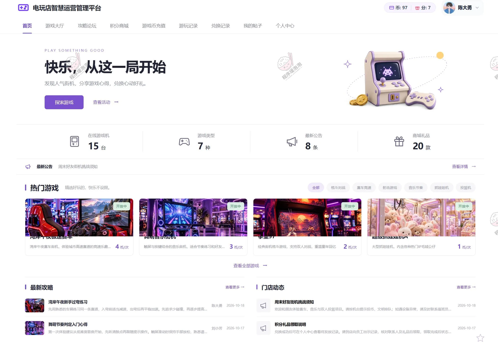</td>
    <td width="50%">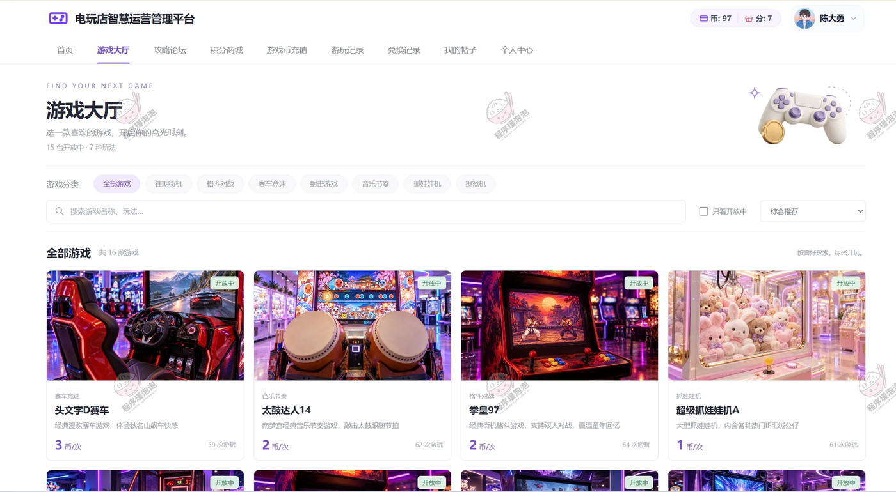</td>
  </tr>
  <tr>
    <td align="center"><b>用户首页</b></td>
    <td align="center"><b>游戏大厅</b></td>
  </tr>
  <tr>
    <td width="50%">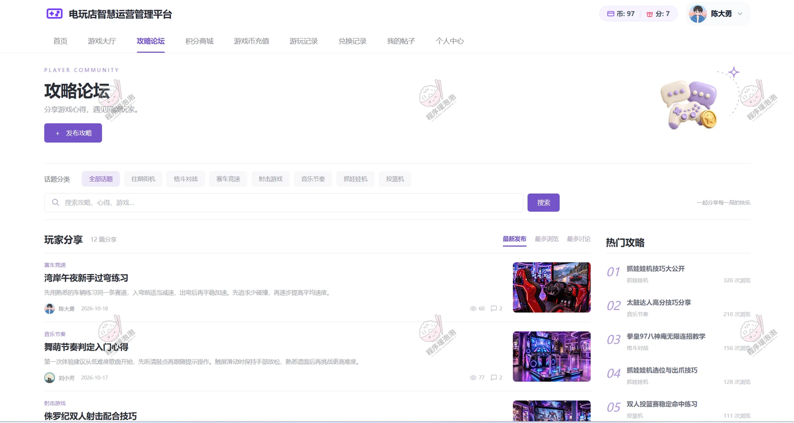</td>
    <td width="50%">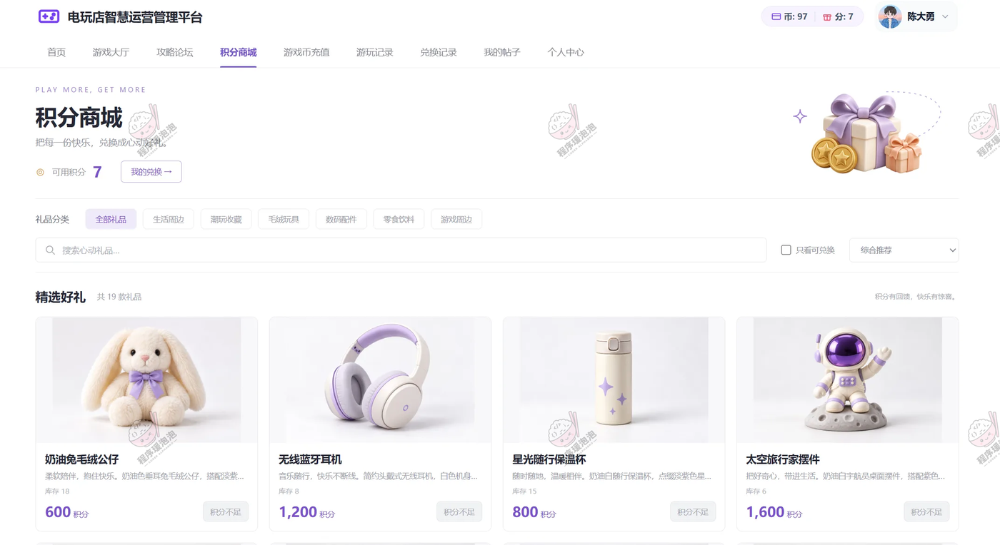</td>
  </tr>
  <tr>
    <td align="center"><b>攻略论坛</b></td>
    <td align="center"><b>积分商城</b></td>
  </tr>
  <tr>
    <td width="50%">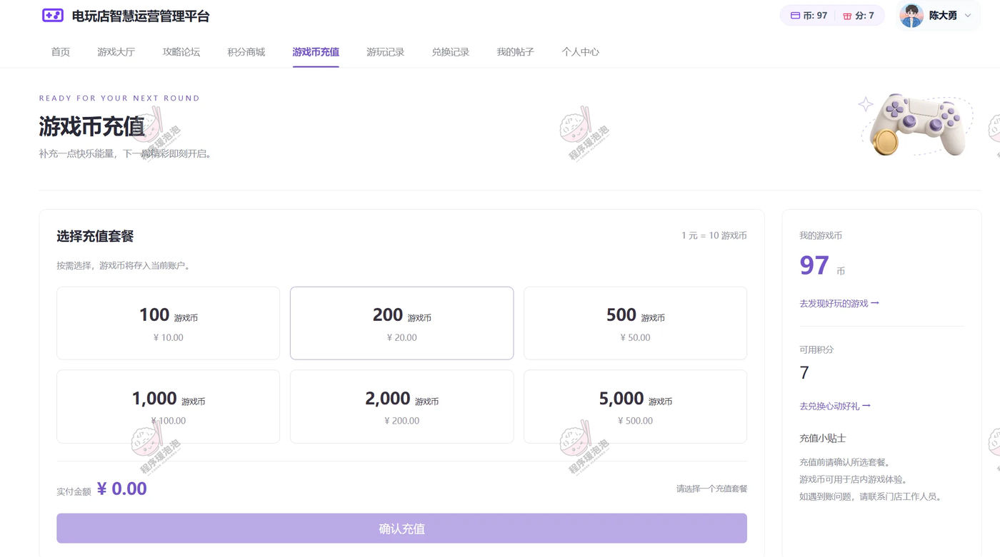</td>
    <td width="50%">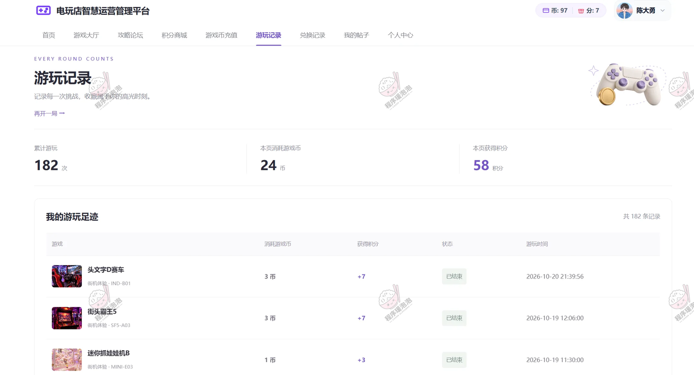</td>
  </tr>
  <tr>
    <td align="center"><b>游戏币充值</b></td>
    <td align="center"><b>游玩记录</b></td>
  </tr>
  <tr>
    <td width="50%">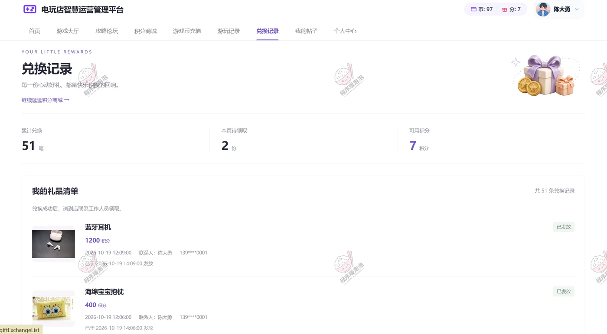</td>
    <td width="50%">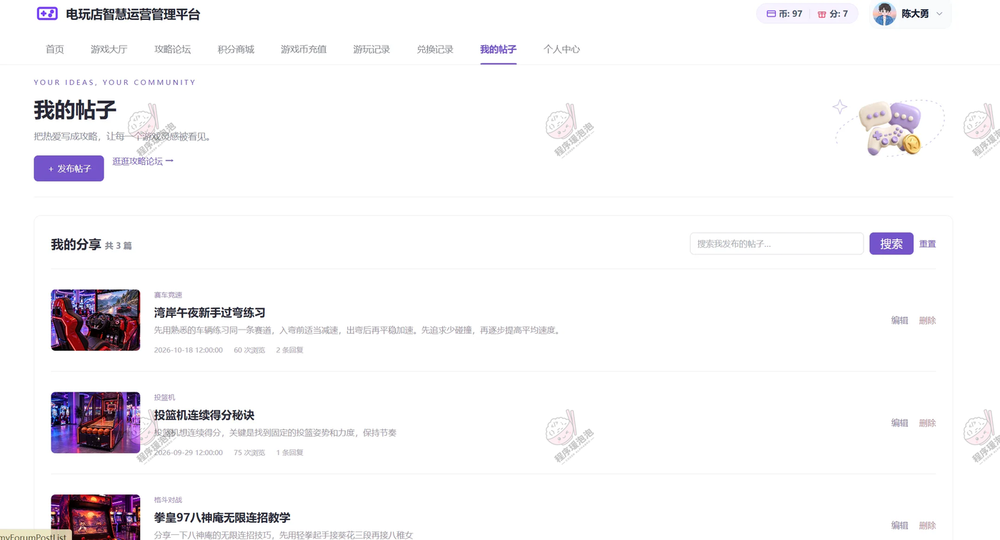</td>
  </tr>
  <tr>
    <td align="center"><b>兑换记录</b></td>
    <td align="center"><b>我的帖子</b></td>
  </tr>
</table>

### 员工端

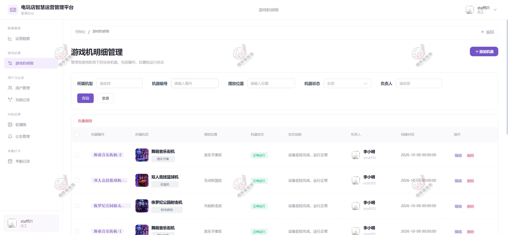

**游戏机明细** — 维护具体机台编号、摆放位置、运行状态、负责人及状态说明，支持运行/维护/故障/下线等状态切换。

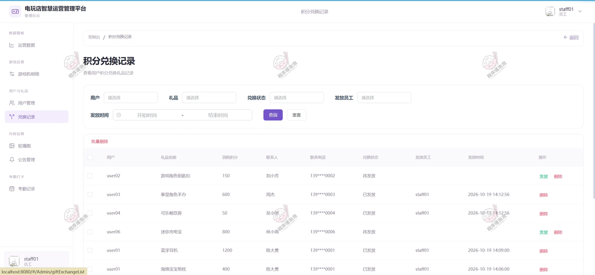

**兑换记录（员工端）** — 查看待发放兑换，确认发放并记录发放员工和时间。

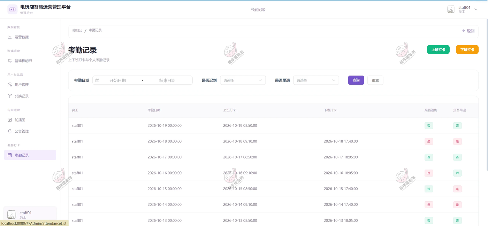

**考勤记录** — 上班签到、下班签退，查看打卡记录及迟到早退状态。

### 老板端

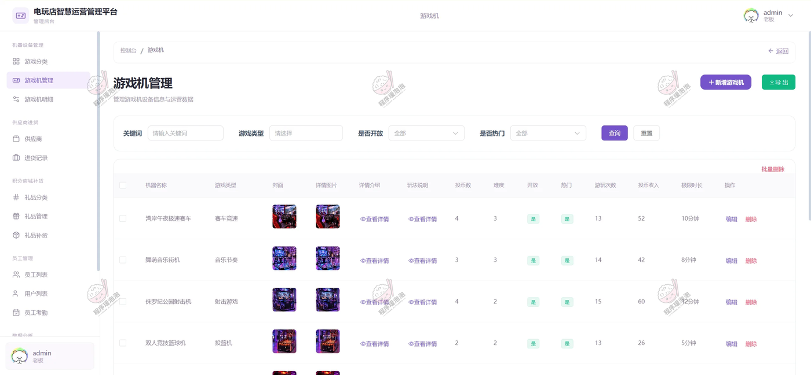

**游戏机管理** — 维护游戏机型、图片、玩法说明、分类、投币数量、难度等级及单次最大游玩时长。

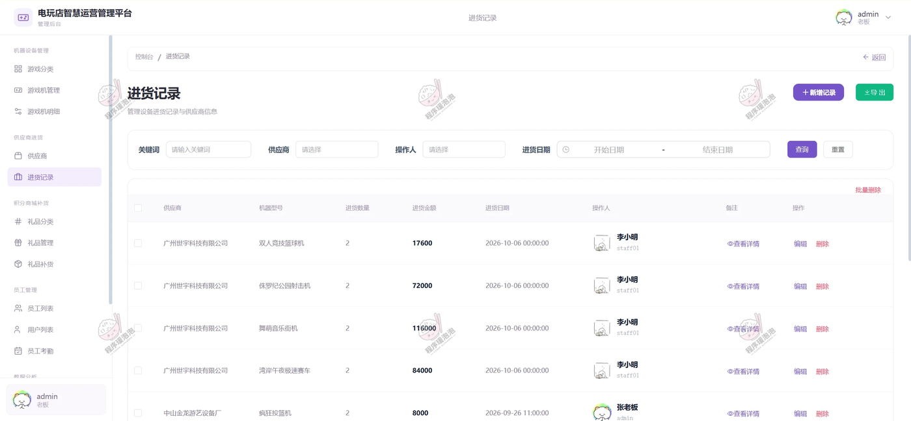

**进货记录** — 维护供应商联系人、地图地址、机器型号、进货数量、金额及进货记录（含腾讯地图选点）。

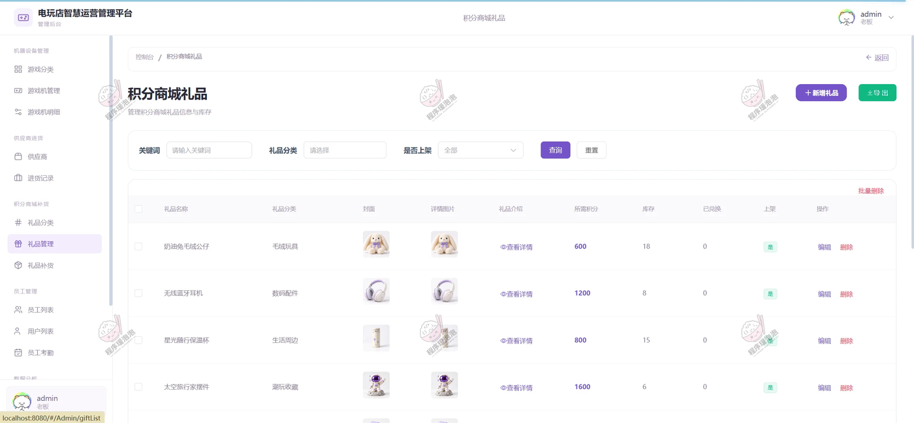

**礼品管理** — 维护礼品分类、所需积分、库存、上下架状态及补货记录。

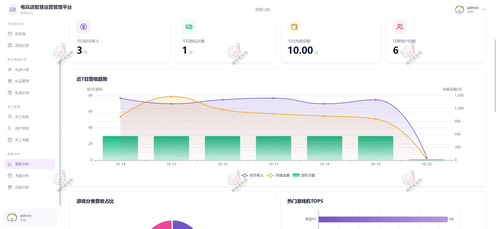

**数据分析** — 按机型营收、日期趋势、分类占比、热门机型、员工考勤及礼品兑换排行，支持投币定价调整。

## 五、结语

文档展示 15 张截图，需要了解更多，请联系我。
